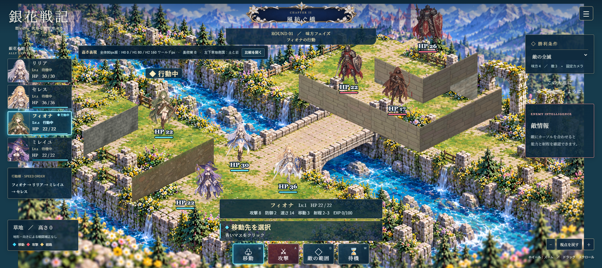
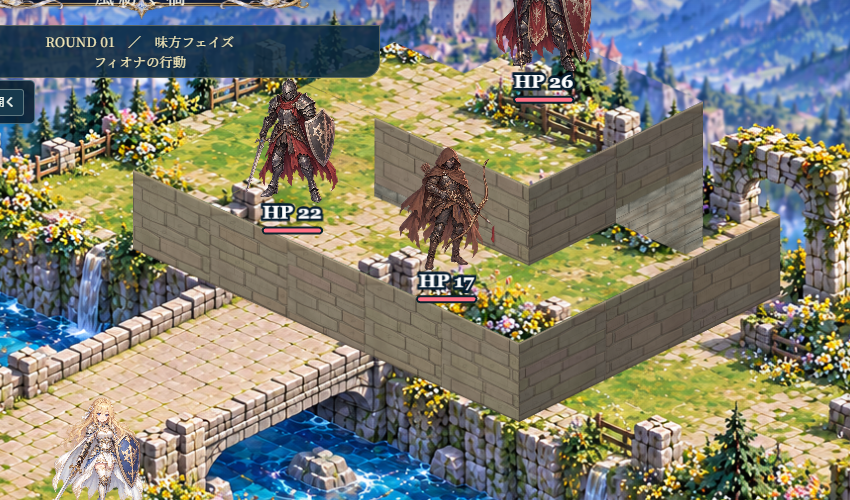
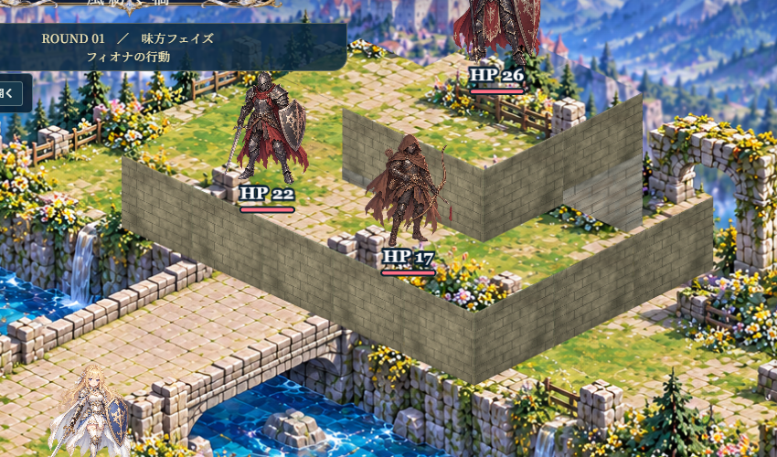

# 全体80px版 北側石壁 C案採用確認

実施日：2026-10-21
ブラウザ：可視起動した外部 Google Chrome  1920×855、deviceScaleFactor 1
確認URL（C案）：`http://127.0.0.1:4175/?height80=1&height80-panel=1&height80-material=soil-rock&height80-art=c&height80-tactics=1&debug=1`

## 採用内容

- 北側石壁のC案を、全体80pxモードの既定美術として採用。
- 全体80pxモードで美術パラメーターを省略した場合もCを選び、アドレス欄へ `height80-art=c` を書き込む。
- A案・B案は比較ボタンと `height80-art=a|b` で引き続き確認できる。
- 通常モードは全体80pxへ切り替えず、従来表示を保つ。
- C案はA案の石面テクスチャを基礎にB案の控えめな左右面の明暗差を組み合わせる。強い目地・大きなブロック輪郭は重ねない。左側草地のB案表現はそのまま。

## 比較画像

同一の初期戦闘状態、カメラ、倍率、材質設定で撮影。クリック操作による状態変化を挟まずA/B/Cを切り替えています。

### グリッドなし全景

| B案 | C案 |
| --- | --- |
|  |  |

### 北側石壁の拡大

| B案 | C案 |
| --- | --- |
|  |  |

### グリッドと経路

- B案：`b-grid-on-same-h1-route.png`
- C案：`c-grid-on-same-h1-route.png`
- 手前／奥の人物表示：`b-current-front-back-units.png` / `c-adjusted-front-back-units.png`
- C案の初期表示・再読み込み・新規タブ：`c-adopted-default-first-open.png` / `c-adopted-default-reload.png` / `c-adopted-default-new-tab.png`

## 操作確認

- C既定表示：指定なしで初回起動・再読み込み・新規タブの全てでCが選ばれ、URLも `height80-art=c` へ揃う。
- 高さの描画量：H0=0、H1=80、H2=160ワールドpx。
- A/B/C切替：比較ボタンで同一の位置・HP・EXP・行動状態・カメラ・高さ対応を保持。
- 左下草地H1：`(1,7)→(2,7)` を通常UIで経路確認・移動・移動取消。元位置と未移動状態へ戻る。
- 北側テラス：検証用開始配置 `(4,2)` H1 から `(4,1)` H2 へ通常UIで移動し、着地と移動取消を確認。開始配置だけをdebug用URLで指定。
- 側壁中央クリック：地面選択・移動が発生しない。
- ズーム・パン後も上面の選択位置を確認。ブラウザページエラーなし。

## テスト結果

- `npm test`：11/11成功。
- `npm run build`：TypeScript検査・Viteビルド成功。
- `tests/height80-material-c-browser.mjs`：外部Chromeで成功。結果は [`results.json`](results.json)。

## 未確認事項

- 北側H1→H2移動はdebug用開始配置からの操作。通常初期配置からの北側到達ではない。
- 北側H2→H1、攻撃・EXP・敵フェイズの通し確認はこのC案採用チェックに含めていない。
- C案の材質は代表区画のみ。全マップの石壁や各地形へ広げていない。
- 既存背景一枚絵に描かれた元地形・装飾の重複は材質案だけでは解消しない。

通常の戦闘画面への高さ変更・公開反映は含まない。C採用は全体80px比較モードの美術既定に限る。

## 採用時の既定表示と通常版の回帰

全体80pxモードで `height80-art` を指定しない場合、C案が自動選択され、URLへ `height80-art=c` が記録されることを確認しました。初回起動・再読み込み・新規タブの画像は `c-adopted-default-first-open.png`、`c-adopted-default-reload.png`、`c-adopted-default-new-tab.png` です。

実験パラメーターなしの通常起動では、全体80pxモードと比較パネルが有効にならず、北側 `(4,0)` は既存の94ワールドpx描画位置を保ちます。画像は `normal-default-unchanged.png`。

この追加確認を含む実行結果は、このフォルダーの `results.json` に保存しています。
